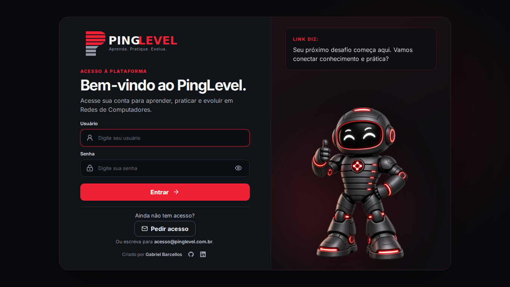
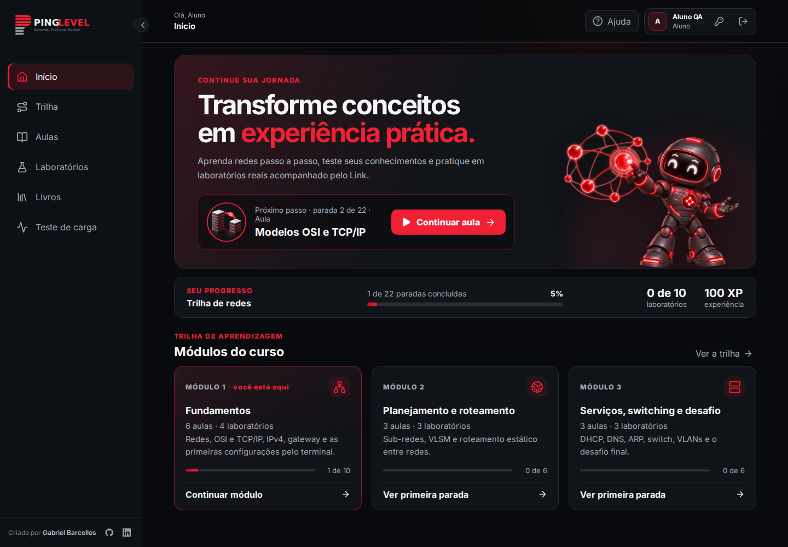
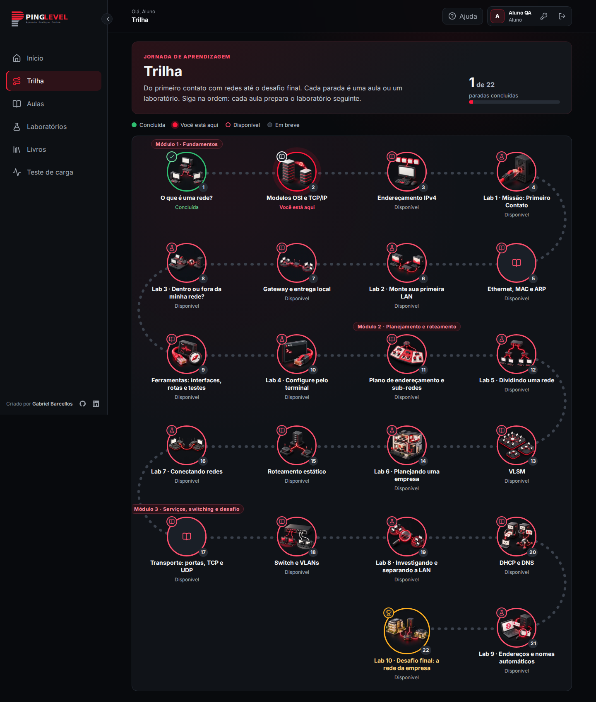
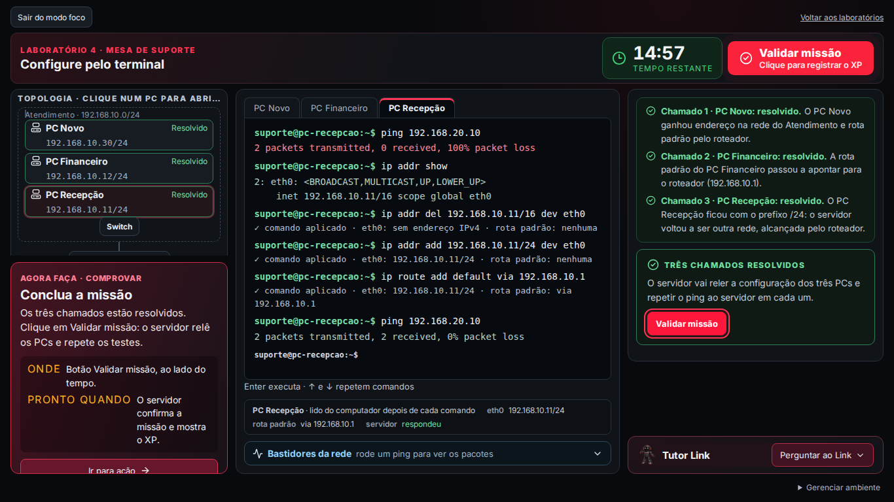
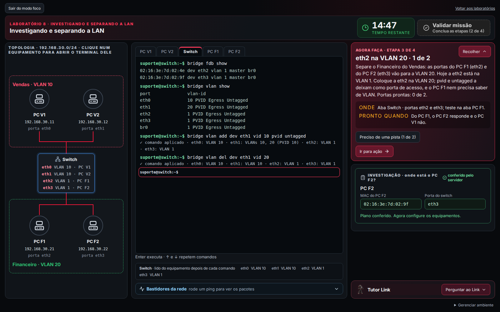
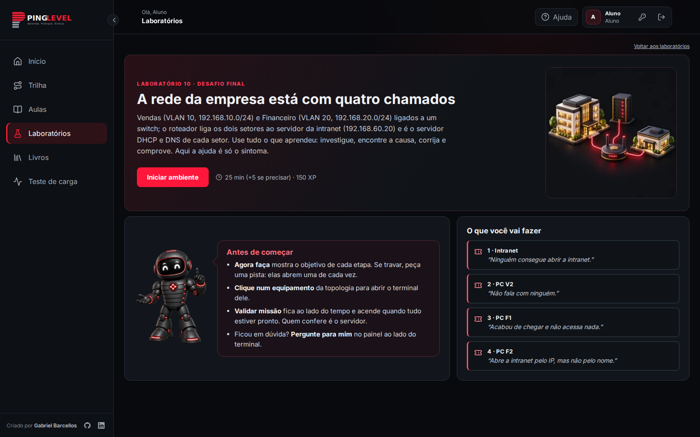

# PingLevel

Plataforma de ensino de **Redes de Computadores** com aulas interativas e laboratórios práticos em topologias reais,
acompanhados pelo **Link**, um tutor que dá pistas sem entregar a resposta.

Criado por **Gabriel Barcellos** ([GitHub](https://github.com/GabrielBarcellos89) ·
[LinkedIn](https://www.linkedin.com/in/gabriel-barcellos-089a8499/)) como Projeto Integrador I.

## O que tem

- **Trilha de 22 paradas** em três módulos: fundamentos (redes, OSI e TCP/IP, IPv4, gateway), planejamento e roteamento
  (sub-redes, VLSM, roteamento estático) e serviços (DHCP, DNS, Ethernet e ARP, switch e VLANs), terminando num
  desafio final.
- **Aulas** que explicam antes de perguntar, com exemplos e desafios curtos.
- **Laboratórios em rede de verdade:** cada aluno recebe a própria topologia no [CORE](https://github.com/coreemu/core)
  com nós em contêineres Docker. O terminal no navegador aceita comandos reais (`ip`, `ping`, `bridge`, `ssh`…), e a
  conclusão de cada etapa é conferida no servidor, olhando o estado da rede.
- **Link, o tutor:** responde com base nos livros de referência (busca RAG), dá pistas graduais e é protegido contra
  pedidos para entregar a resposta.
- **Professores e administração:** turmas, contas provisórias, progresso dos alunos e pedidos de acesso.

| Início | Trilha |
| --- | --- |
|  |  |

| Terminal no laboratório | Switch e VLANs | Desafio final |
| --- | --- | --- |
|  |  |  |

## Arquitetura

| Parte | Tecnologia | Onde |
| --- | --- | --- |
| Frontend | React + Vite | `frontend/` |
| Backend HTTP, autenticação, progresso | Python (biblioteca padrão) + SQLite | `app/prototipo/` |
| Laboratórios (sessões, cenários, validação, terminal) | Python + CORE + Docker | `app/laboratorios/` |
| Tutor Link | Claude (Anthropic) + RAG sobre os livros | `app/laboratorios/tutor_*.py`, `app/rag/` |
| Imagens dos nós | Docker | `images/` |
| Testes e publicação | unittest, pytest, node:test, Playwright | `tools/qa/`, `frontend/tests/` |

O terminal dos laboratórios não abre um shell: os comandos são interpretados e validados antes de chegar ao nó.

## Agradecimentos

O tutor Link e a página de livros usam as obras do professor **Eduardo Maroñas Monks**, entre elas
*Redes para Iniciantes* e *Linux: Utilitários de Redes*, com a autorização dele. Muito obrigado, professor, pela
generosidade em permitir esse uso e por todo o apoio ao projeto.

## Observações

- Este repositório é uma cópia pública do código. O desenvolvimento acontece num repositório privado.
- Os livros, o índice de busca e os bancos de dados não fazem parte do repositório.
- Para rodar, é preciso um servidor Linux com CORE 9 e Docker; os caminhos de produção estão fixos no código.

## Licença

Código disponível apenas para consulta: todos os direitos reservados. Veja [LICENSE](LICENSE).
